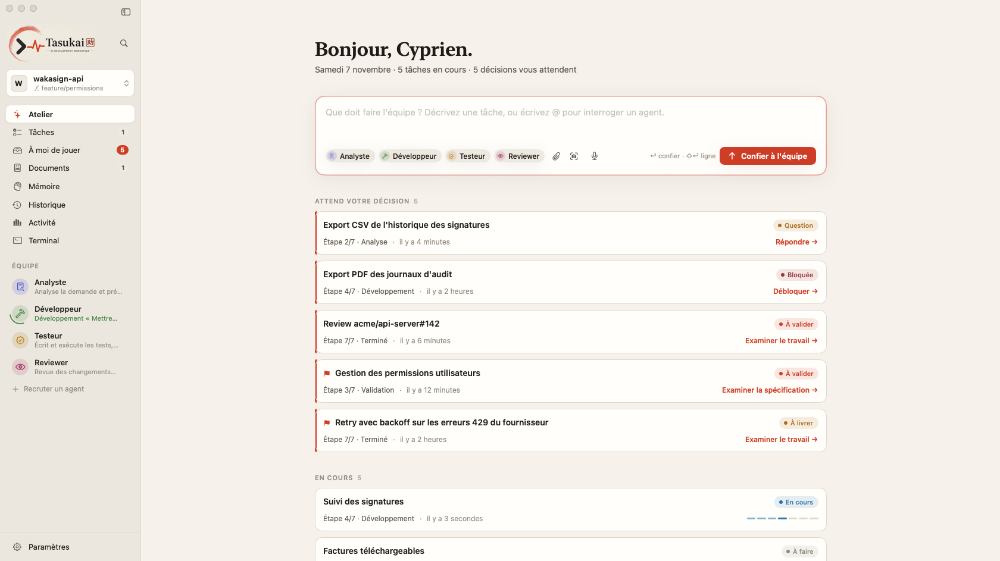

<p align="center">
  <picture>
    <source media="(prefers-color-scheme: dark)" srcset="assets/img/banner-dark-transparent.png">
    
  </picture>
</p>

<p align="center"><strong>Déléguez le développement à une équipe d'agents IA. Gardez la main sur chaque décision.</strong></p>

<p align="center">
  <a href="https://cyprienbrisset.github.io/tasukai-public/">Site</a> ·
  <a href="https://github.com/cyprienbrisset/tasukai-public/releases/latest/download/Tasukai.dmg">Télécharger (.dmg)</a> ·
  <a href="https://github.com/cyprienbrisset/tasukai-public/releases">Versions</a> ·
  <a href="https://github.com/cyprienbrisset/tasukai-public/issues">Signaler un problème</a>
</p>

---

**Tasukai** (助け合い, « s'entraider ») est une application macOS native où une équipe d'agents — **Analyste**, **Développeur**, **Testeur**, **Reviewer** — développe pour vous en s'appuyant sur [Claude Code](https://docs.anthropic.com/claude-code). Vous décrivez le besoin ; l'équipe rédige la spécification, implémente sur une branche isolée, teste, relit, et ne vous sollicite que lorsqu'une décision humaine est nécessaire.

<p align="center"></p>

Ce dépôt contient les **versions publiées** et le **site** de Tasukai.

## Installation

1. Téléchargez [`Tasukai.dmg`](https://github.com/cyprienbrisset/tasukai-public/releases/latest/download/Tasukai.dmg) et glissez Tasukai dans Applications.
2. Cette version n'est pas encore notarisée : au premier lancement, ouvrez **Réglages Système › Confidentialité et sécurité › Ouvrir quand même**, ou exécutez :
   ```bash
   xattr -dr com.apple.quarantine /Applications/Tasukai.app
   ```

**Prérequis** : macOS 14+ (Intel ou Apple Silicon), [Claude Code](https://docs.anthropic.com/claude-code) installé et authentifié, Git ; `gh` facultatif pour les pull requests et reviews GitHub.

Toutes les fonctionnalités sont présentées sur le [site](https://cyprienbrisset.github.io/tasukai-public/).
